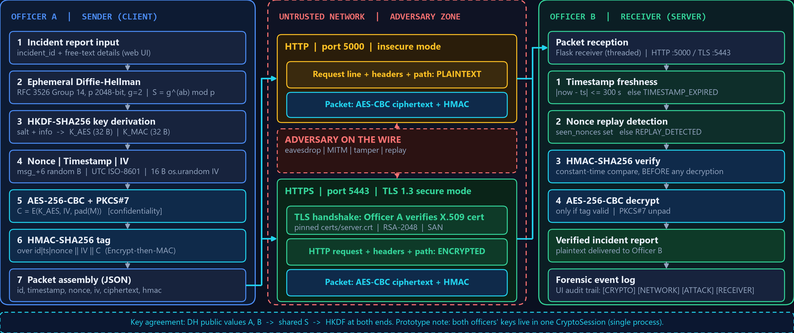
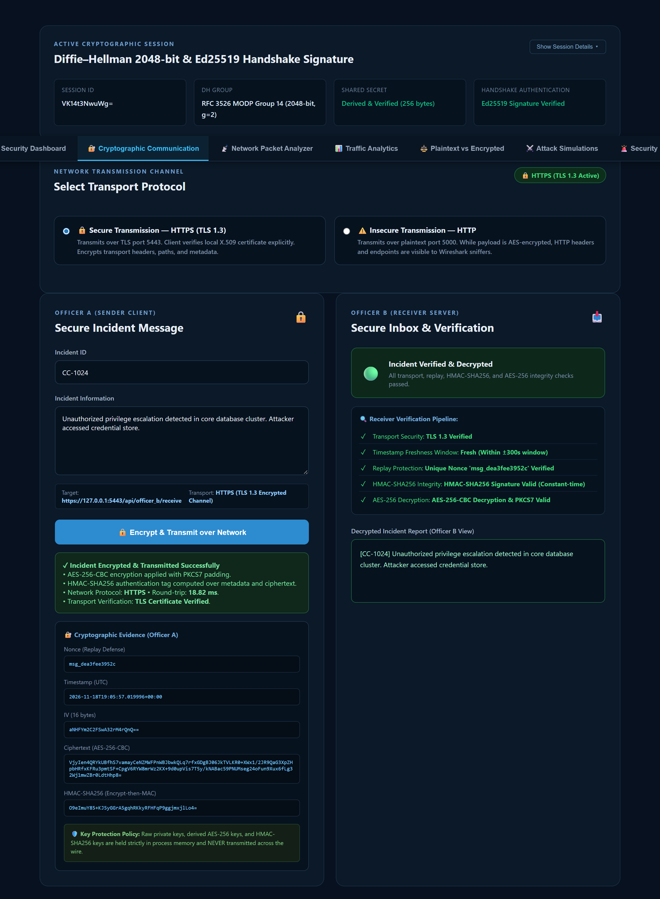
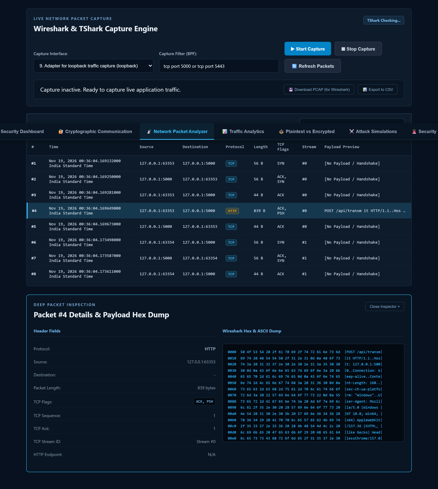
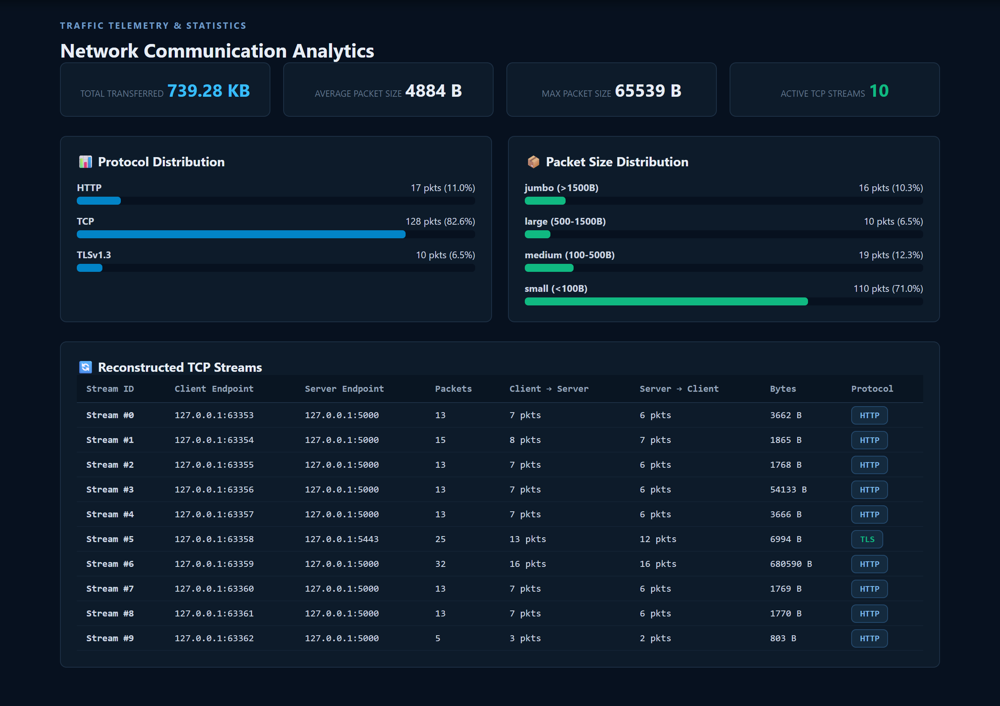
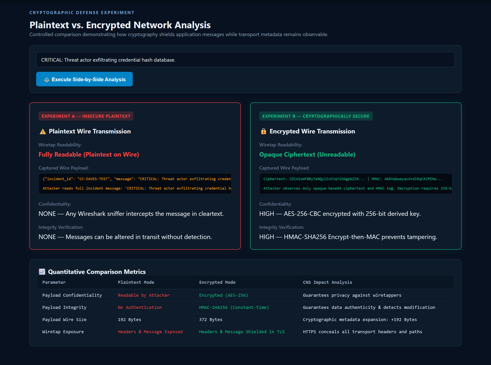
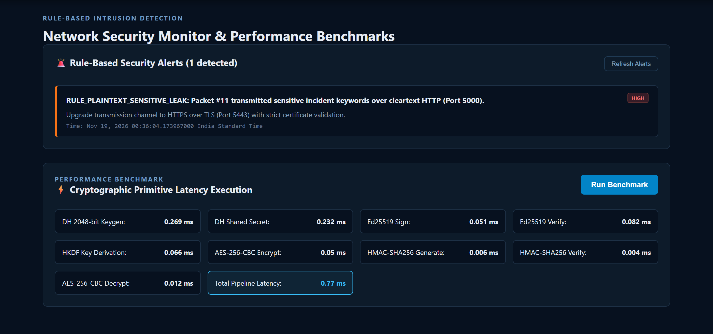
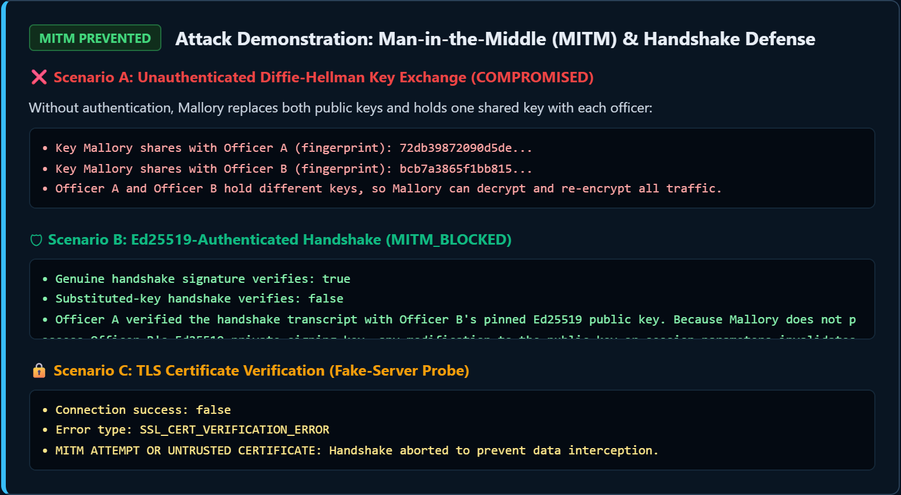
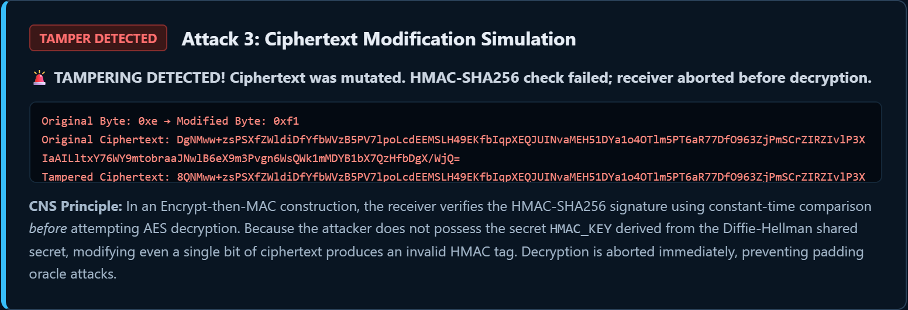
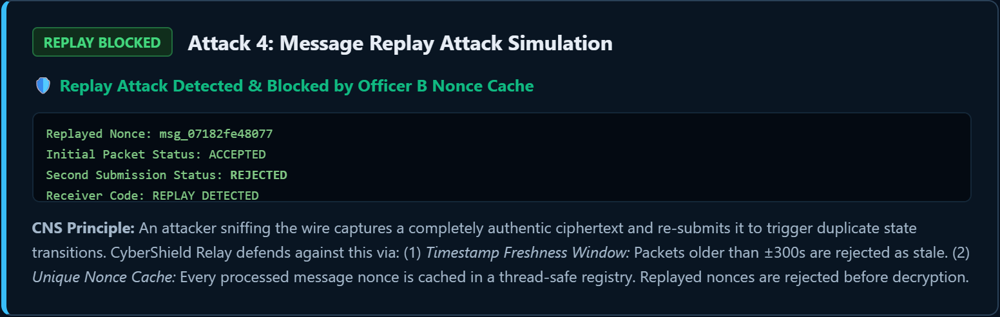

# CyberShield Relay

**Secure cyber-incident communication using cryptographic and network-security mechanisms.**

CyberShield Relay lets *Officer A* send a sensitive incident report to *Officer B* over HTTP or HTTPS. The report is protected by application-layer cryptography, and the resulting real network traffic can be captured with Wireshark/TShark and analysed in a browser dashboard. Four attacks (eavesdropping, man-in-the-middle, tampering, replay) are run against the system to show that each one fails.



## Table of contents
1. [Features](#features)
2. [How it works](#how-it-works)
3. [Project structure](#project-structure)
4. [Technology stack](#technology-stack)
5. [Getting started](#getting-started)
6. [Using the dashboard](#using-the-dashboard)
7. [Attack demonstrations](#attack-demonstrations)
8. [Testing](#testing)
9. [Screenshots](#screenshots)
10. [LAN mode](#lan-mode)
11. [Limitations](#limitations)

## Features
| Area | What is implemented |
|---|---|
| Key exchange | Ephemeral Diffie-Hellman, RFC 3526 group 14 (2048-bit) |
| Handshake authentication | Ed25519 signature over the handshake transcript (session id, both public keys, nonce) |
| Key derivation | HKDF-SHA256, 64 bytes split into an AES key and an HMAC key |
| Confidentiality | AES-256-CBC, random 16-byte IV, PKCS#7 padding |
| Integrity | HMAC-SHA256 over `id \| timestamp \| nonce` + IV + ciphertext (Encrypt-then-MAC), constant-time check |
| Replay defence | 300 s timestamp window and a one-time nonce cache |
| Transport | HTTP on port 5000 and HTTPS (TLS 1.3) on port 5443; the client pins the server's X.509 certificate and never disables verification |
| Packet capture | TShark/Npcap capture to PCAPNG, packet table, hex/ASCII inspector, PCAP download, CSV export |
| Analytics | Protocol mix, packet sizes, reconstructed TCP streams, rule-based alerts (no machine learning) |
| Audit | In-memory event log with filters, JSON report, crypto primitive benchmark |

## How it works
**Officer A (sender)**
1. Enter the incident ID and details.
2. Diffie-Hellman key exchange; the handshake is signed with Ed25519 so key substitution is detected.
3. HKDF-SHA256 derives separate encryption and authentication keys.
4. Generate a random nonce, UTC timestamp and IV.
5. Encrypt with AES-256-CBC, then compute the HMAC-SHA256 tag.
6. Send the JSON packet (`incident_id, timestamp, nonce, iv, ciphertext, hmac`) over HTTP or HTTPS.

**Officer B (receiver)** checks in this fixed order and stops at the first failure:

`timestamp fresh` -> `nonce unused` -> `HMAC valid` -> `AES decrypt`

Rejections carry an error code: `TIMESTAMP_EXPIRED`, `REPLAY_DETECTED`, `HMAC_VERIFICATION_FAILED`. Decryption is never attempted on an unverified packet, and the receiver does not send the plaintext back over the network.

**Over HTTP** the request line and headers are readable on the wire; **over HTTPS** everything is hidden inside TLS records. The payload is AES-encrypted in both cases.

## Project structure
```
app.py                 Flask REST API, dashboard host, HTTP (5000) + HTTPS (5443) servers
crypto_engine.py       CryptoSession facade tying the crypto modules together
network_engine.py      X.509 certificates, NetworkClient (HTTP/HTTPS), ReceiverState
crypto/                dh_exchange, handshake_authentication (Ed25519), key_derivation (HKDF),
                       aes_encryption, hmac_authentication
network/               packet_capture (TShark), packet_parser, network_analyzer,
                       traffic_monitor, replay_protection, interception_proxy, network_config
security/              eavesdropping, mitm_simulation, tampering, replay_attack, security_events
analysis/              crypto benchmark, network metrics, JSON report generator
templates/ static/     dashboard (HTML, CSS, JavaScript)
tests/  test_suite.py  pytest suite and end-to-end script
captures/              sample PCAPs used by the tests
docs/images/           architecture diagram and screenshots
```
`certs/` (generated on first start) is not tracked by git.

## Technology stack
| Layer | Technology |
|---|---|
| Backend | Python 3, Flask, Werkzeug threaded servers, `requests`, `psutil` |
| Cryptography | `cryptography` library (DH, Ed25519, HKDF, AES, HMAC, X.509) |
| Network analysis | Wireshark / TShark, Npcap (Windows loopback), PCAP/PCAPNG |
| Frontend | HTML, CSS, vanilla JavaScript |
| Testing | pytest, end-to-end script |

## Getting started
**Prerequisites:** Python 3.10+ (developed on 3.13). Packet capture additionally needs **Wireshark with TShark** (set `TSHARK_PATH` if it is not on the default path) and, on Windows, **Npcap** with loopback support. Everything except capture works without them.

```bash
git clone git@github.com:HarshaNaik8/Cybershield-Relay.git
cd Cybershield-Relay
python -m venv venv
source venv/bin/activate          # Windows: .\venv\Scripts\Activate.ps1
pip install -r requirements.txt
python app.py
```
Open <https://127.0.0.1:5443> and accept the browser warning for the self-signed certificate (plain HTTP is also available at <http://127.0.0.1:5000>). Over HTTPS, the text you type is not sent in clear form between the browser and the app. Certificates are generated into `certs/` on first start. Stop with `Ctrl+C`.

**Packet capture on Ubuntu/Debian:**
```bash
sudo apt install tshark                 # answer "Yes" to non-superuser capture
sudo usermod -aG wireshark $USER        # then log out and log in again
```

## Using the dashboard
| Tab | Purpose |
|---|---|
| Security Dashboard | Session status and quick actions |
| Cryptographic Communication | Send an incident over HTTP or HTTPS and watch Officer B's five checks |
| Network Packet Analyzer | Start/stop a real capture, browse packets, hex dump, download PCAP, export CSV |
| Traffic Analytics | Protocol distribution, packet sizes, TCP streams |
| Plaintext vs Encrypted | Same message as seen on the wire under HTTP, HTTPS and AES |
| Attack Simulations | Run the four attacks |
| Security Monitor | Rule-based alerts from the latest capture |
| Audit Log | Filterable event log and JSON report |

**Capturing packets:** in *Network Packet Analyzer* choose the loopback adapter, keep the filter `tcp port 5000 or tcp port 5443`, press **Start Capture**, send one incident over HTTP and one over HTTPS, then **Stop Capture**. If TShark, Npcap or permissions are missing the page says so; no packets are invented.

## Attack demonstrations
All attacks run against this application on the local machine only.

| Attack | What you see | Why it fails |
|---|---|---|
| Eavesdropping | HTTP: headers readable; HTTPS: TLS records only | AES hides the payload, TLS hides headers |
| Man-in-the-middle | Unsigned DH is hijacked; signed DH is blocked; fake certificate refused | Ed25519 transcript signature, pinned X.509 certificate |
| Tampering | One flipped ciphertext byte is detected | HMAC fails before any decryption |
| Replay | A resent packet is rejected | Nonce already used / timestamp outside 300 s |

## Testing
```bash
python -m pytest tests -v     # unit, integration, live-capture tests
python test_suite.py          # 8 end-to-end scenarios (starts its own servers)
```
Stop `app.py` first; the tests use ports 5000 and 5443. Tests that need TShark or loopback capture skip themselves when it is unavailable.

| Environment | pytest | `test_suite.py` |
|---|---|---|
| Windows 11, TShark + Npcap | 62 passed | 8 passed |
| Ubuntu Linux, without TShark | 56 passed, 6 skipped | 8 passed |

| Group | Covers |
|---|---|
| `test_crypto.py` | DH, HKDF, AES, HMAC, Ed25519, receiver ordering |
| `test_integration.py` | Live HTTP/HTTPS servers, TLS, certificate checking |
| `test_api.py` | REST endpoints and errors |
| `test_security_attacks.py` | Attack demos, replay engine |
| `test_packet_analysis.py`, `test_network_capture.py`, `test_live_capture.py` | Parsing, streams, alerts, real capture |

## Screenshots
| | |
|---|---|
|  |  |
|  |  |
|  |  |
|  |  |

## LAN mode
The default is localhost. Set `CYBERSHIELD_MODE=LAN` before `python app.py` to bind both servers to `0.0.0.0`, allow ports 5000/5443 in the firewall, and use the address shown by `GET /api/network/config`. For HTTPS from another machine the certificate must list that address as a Subject Alternative Name (delete `certs/server.*` to regenerate). LAN operation between two computers is untested.

## Limitations
- Both officers' keys live in one process (`CryptoSession`); the Ed25519 identity is regenerated at start-up.
- Self-signed pinned certificate; TLS authenticates the server only; TLS 1.3 is observed, not enforced.
- Replay cache is in memory and lost on restart; nonces are 48 random bits.
- HMAC gives no non-repudiation; the informational `protocol` field is not authenticated.
- The legacy `/api/receive` endpoint returns the decrypted message to its caller.
- Flask development server, unauthenticated endpoints, in-memory audit log.
- The browser-to-app request of the dashboard is outside the protected A-to-B packet: over plain HTTP it carries the typed text, and its reply carries the decrypted text for display.
- The **Plaintext vs Encrypted** panel is an illustration built by the application; real wire evidence comes from packet capture.
- The dashboard's "Operating Environment" card shows `(undefined)` instead of the bind address (display issue only).
- Finite-field DH is deprecated in the `cryptography` library.

**Possible future work:** X25519 ECDH, AES-GCM, mutual TLS, a persistent nonce store, a two-machine test with a trusted certificate authority.
